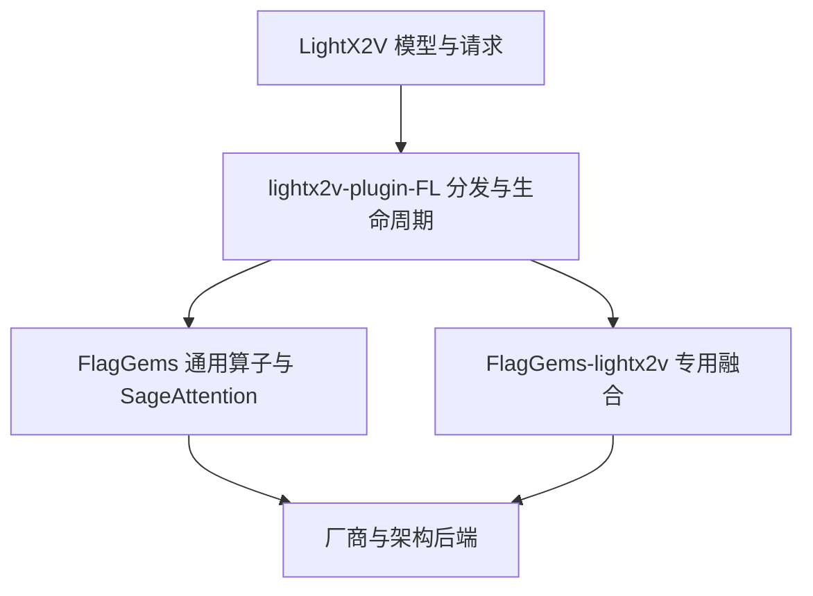

# LightX2V/H3 优化设计

本文说明长期维护的计算契约与接入方式。具体提交的耗时、设备日志和验收结果放在对应 PR；历史算子结果不能替代打包后提交的验证。

## 分层与调用链

框架负责模型配置、权重加载、调度、序列并行、持久 buffer、图捕获和补丁安装。本库接收明确的 tensor/参数，执行一次数值计算，不修改 runner、不注册全局 ATen、不持有模型或请求。框架仅通过公开 API 调用数值实现。

通用 SageAttention 归入 FlagGems；本库保留依赖 H3 既有布局、精度边界或调度公式的数值契约。公共 API 与 kernel 参考实现分离，测试不得用被测 kernel 生成 expected。

## 三档特性预算

1. `sm90`：允许 Gluon、PTX 等芯片特化。RMS 使用与 H100 原生实现一致的归约分组与乘法顺序。通用 Sage 的 SM90 实现使用 FlagTree/TLE 的架构特性，QK 为 INT8，PV 为 FP8。不同算子不要求使用同一种编程风格。
2. `tle`：在普通 Triton 之上仅使用 TLE；目前 RMS 与 INT8-QK/BF16-PV Sage 的具体硬件范围为 MTT S5000。MUSA 的 TLE 矩阵 API 虽沿用 `wgmma` 名字，实际代码由 MUSA 后端生成，不能据此宣称使用 NVIDIA 指令。
3. `baseline`：普通 Triton，不依赖 TLE、Gluon、TMA 或手写厂商指令。矩阵计算使用基础 `tl.dot`。保留这一档以便新后端先验证公共语义。

没有证据表明高级特性对每个算子都有收益。VAE 融合目前复用普通 Triton 实现，不能将同一个实现的转发层包装成新的厂商优化。RMS 的 portable 路径曾在 H100、S5000 运行；A100 仅有离线编译证据。VAE 模型级验收覆盖 H100，不能由 RMS 的 S5000 测试推导出完整 H3 已支持 S5000，更不能推导其他国产芯片已经通过。

## DiT：RMS、SwiGLU 和精度边界

H3 的 RMS 契约是 FP32 累加、FP32 乘 weight，再一次性转换回 BF16。先将归一化结果转回 BF16、再乘 weight 的普通 RMS 接口不是同一计算契约。D128 与 D5376 的原生归约分组也不同；架构特化路径保留相应的累加、shuffle 和除法顺序。

权重驻卡由框架管理。portable RMS 要求 weight 与输入同设备；SM90 另保留已验证的 mapped pinned-host ABI。框架应在预热/图捕获前完成小权重驻卡，不能在每层热路径重复拷贝，也不能在算子内部偷偷缓存模型权重。

H3 FFN 的 packed 输入为 `[value | gate]`。它先独立计算低精度 `SiLU(gate)`，再与 value 相乘。将两个步骤都在 FP32 中完成、最后只舍入一次，或者把 gate/value 顺序交换，都会改变输出。本库的 `h3_swiglu` 保留这一物化边界。框架只对已经验证的非量化 FFN、布局和形状启用融合；原 GEMM、LoRA/diff 路径和小形状策略由框架保留。

packed 输入可能超过 `INT32_MAX` 个元素，即使输出元素数还没有超过。地址计算必须使用足够宽的整数；不能只根据输出 tensor 的大小选择索引宽度。本实现的大输入地址使用64位，并单独验证越过32位边界的形状、最后一行和 Graph 输入刷新。

## SageAttention：量化语义不能混用

SM90 路径使用 per-thread INT8 Q/K 和 FP8 P/V。portable 两档使用 INT8 Q/K、BF16 P/V 和 FP32 累加。这两种路径是不同的数值契约，必须显式选择，不能在失败后把 FP8 改成 BF16 或 dense SDPA 继续执行。

K 均值、输入精度下的中心化、量化比例、舍入、概率物化和输出 dtype 都属于契约。原生 K 均值的归约顺序对量化边界有影响，单独验证公式相等不足以证明量化结果相等。公开 API 对布局、D128、相同 head 数、stride、scale、非 causal 和不返回 LSE 的边界明确检查。尚未支持的 mask、GQA、dropout 或 backward 不得静默忽略。

框架用独立 Sage 注册入口表达这一选择。已有 dense SDPA 的注册和参数语义继续保留。执行前可根据已知 API/硬件能力选择实现；开始量化或发射 kernel 后，异常必须直接传播，禁止换后端重试。

## VAE：融合局部链路，保留敏感组件

视频 VAE 的 Q/K 归一化使用 FP32 累加，随后转换为推理精度，再进行48通道 split RoPE；余下16通道保留。RoPE 乘法与加法的低精度边界不能合并成一个不同的表达式。

残差状态、scale 和 RMS 权重为 FP32；attention/FFN update 为 FP16。`h3_vae_residual_norm` 可融合 residual 与后续 RMS，但保持原先分别舍入的算术。输出为新的 tensor，调度状态由框架替换，不做隐藏的原地写入。

GEMM 与 attention 继续使用已验证的 native/vendor 路径。VAE 的 SDPA 在已测 H100 链路中实际使用 FlashAttention；不能仅凭函数名判断为慢速 math SDPA。未经精度验收的其他 attention 实现不随融合一起切入。音频 VAE 保留 FP32，不能为了方便统一转成 BF16。

是否 offload 是框架显存策略，与数值算子分开。完整 VAE 驻卡时仍可把解码输出返回 CPU，避免后续媒体编码收到错误设备上的 tensor。不能由某个固定 embedding 工况的显存结果推断加载文本编码器、所有帧数和所有并行配置都能全驻卡。

## 调度与图执行

`h3_reference_blend` 只消费 sample、prediction、timestep、sigmas 和 step index，返回 FP32 更新。调度器拥有 schedule、step mode、状态演进和生命周期。除法、乘法与加法的分组保持原公式，不启用改变这些边界的 FMA 合并。

算子可分配单次调用输出/临时 buffer；跨调用缓存、稳定地址、跨 stream event 和显存预算由框架负责。Graph 测试必须更新输入并污染输出后再 replay，不能只验证一个未变化的旧输出。

## 正确性验收边界

算子测试分别覆盖数学参考、dtype/stride/尾部、非法参数、输入不变与 Graph 刷新；接线测试验证实际命中和失败不重试。模型比较固定相同 embedding、初始 latent、seed、采样和并行配置，区分原始 tensor、最终视频以及编码后的像素。

编码后的差异不能直接归因于算子；反之，编码成功也不能代替 tensor 验收。完整 tensor 验证覆盖了哪轮、媒体比较覆盖了哪轮、是否只抽样，以及未知的编码问题，都应在 PR 中如实说明。
